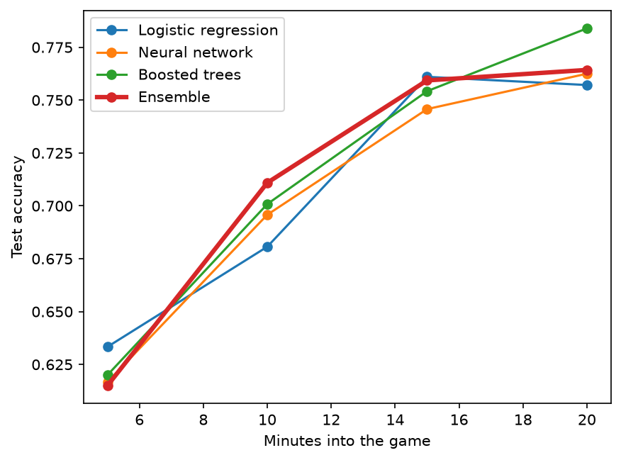
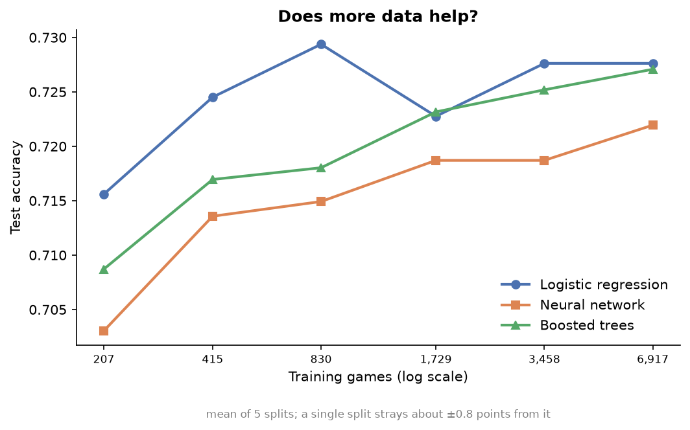
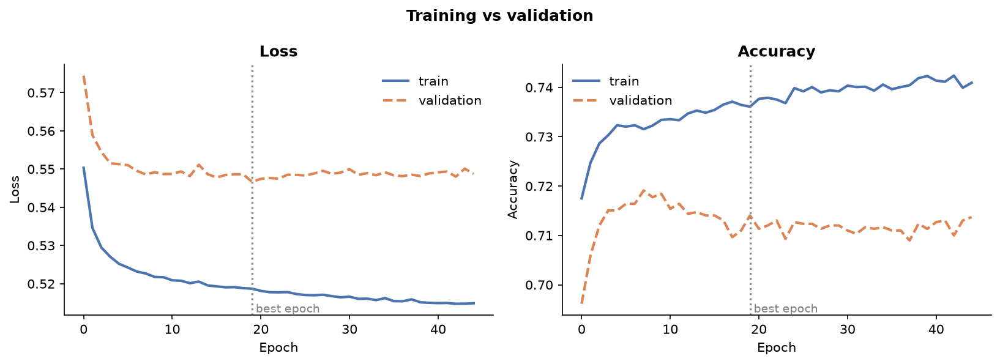
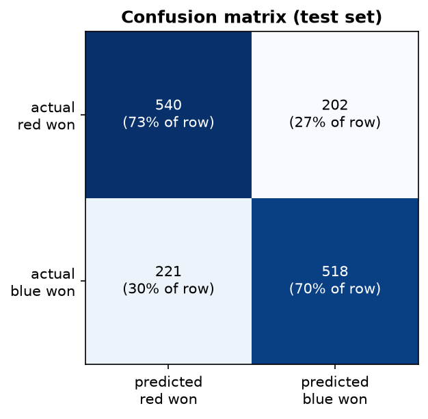
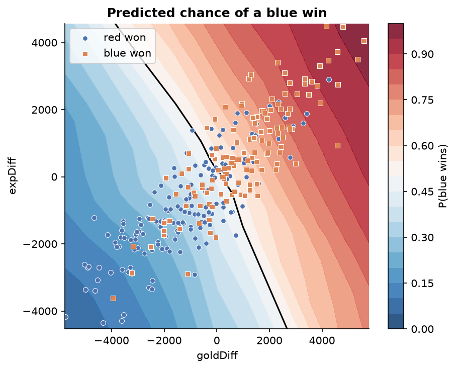
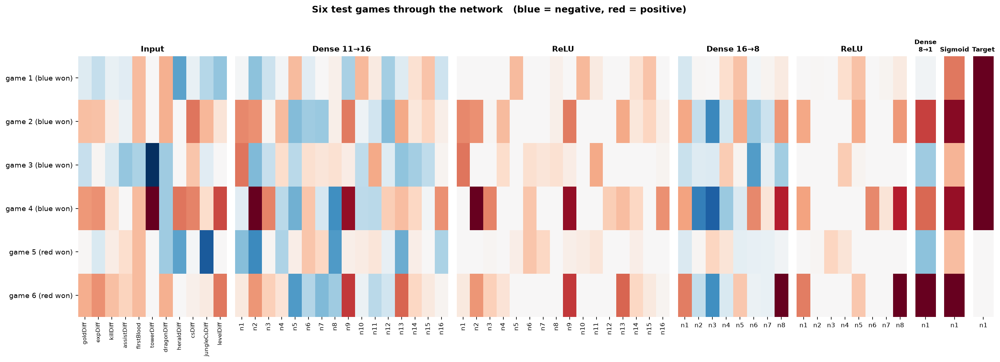

# test_neural_network
A small, modular feed-forward neural network written from scratch with only NumPy, then
used to predict the winner of **League of Legends** games from their first 10 minutes.
No TensorFlow, no PyTorch: forward pass, backpropagation, losses, optimizers, and the
training loop are all implemented in this repository.

It was built to answer two questions: *can I implement backpropagation correctly and
cleanly?* (verified with numerical gradient checks) and *what can a small network learn
from real data?* (about 73% accuracy at predicting the winner, against 50% for guessing).
The honest answer to the second question is that **a plain logistic regression does at least as
well as the network, the boosted trees and their ensemble** on these 11 features (see
[Results](#results)). The network is here to show how it works, not because this data needs it.

| Part | Files |
|---|---|
| Layers: base `Layer`, `Dense`, activations (`Tanh`, `Sigmoid`, `ReLU`) | `nn/layer.py`, `nn/dense.py`, `nn/activations.py` |
| Losses: MSE, binary cross-entropy | `nn/losses.py` |
| Optimizers: SGD, SGD with momentum, Adam | `nn/optimizers.py` |
| Training loop: mini-batches, validation, early stopping with best-weights restore | `nn/network.py` |
| Data pipeline: CSV loader, train/val/test split, standardization | `nn/data.py` |
| Metrics and diagnostics: accuracy, confusion matrix, majority baseline, overfitting report | `nn/metrics.py`, `nn/diagnostics.py` |
| Exact logistic regression (Newton's method), the baseline every other model has to beat | `nn/logistic.py` |
| Blue/red mirror: train on every game from both teams' points of view, average the two answers | `nn/symmetry.py` |
| Save / load a trained model (weights + scaler) | `nn/persistence.py` |
| Visualizations | `nn/visualize.py` |
| Examples | `examples/xor.py`, `examples/lol_winner.py`, `examples/predict_game.py`, `examples/compare_models.py`, `examples/cross_validate.py`, `examples/learning_curve.py`, `examples/anytime.py` |
| Tests (45) | `tests/` |

Features: L2 regularization, He / Xavier initialization, overflow-safe sigmoid.


## Design

A network is a plain Python list of layers:

```python
network = [Dense(11, 16, init="he"), ReLU(), Dense(16, 8, init="he"), ReLU(), Dense(8, 1), Sigmoid()]
```

Every layer follows one contract:

- `forward(X)` returns `Y` and remembers whatever it needs for the backward pass.
- `backward(dE/dY)` returns `dE/dX` (the gradient for the previous layer) and stores the gradients
  of its own parameters. **It never changes its own weights.**
- `params()` / `grads()` expose the trainable arrays and their gradients.

Updating weights is the optimizer's job (`optimizer.step(params, grads)`). Keeping the two
apart means any layer works with any optimizer, and gradients can be checked numerically
without the weights shifting underneath the check.

One training step:

1. **Forward:** feed a batch through every layer.
2. **Error:** compare the output with the target using the loss function.
3. **Backward:** pass `dE/dY` back through the layers in reverse order (chain rule).
4. **Update:** the optimizer adjusts the parameters using the stored gradients. Repeat.

### The math implemented

**Dense layer**, with batch input `X` of shape `(batch, n_in)`:

```
forward:   Y = X W + b
backward:  dE/dW = Xᵀ · dE/dY  (+ λW with L2 regularization)
           dE/db = sum of dE/dY over the batch
           dE/dX = dE/dY · Wᵀ
```

**Activation layer** (elementwise): `dE/dX = dE/dY ⊙ f'(X)`, with
`tanh' = 1 − tanh²`, `sigmoid' = σ(1 − σ)`, and `relu' = 1 if x > 0 else 0`.

**Losses** (averaged over all elements of the batch, so the learning rate does not depend on batch size):

```
MSE:  E = mean((y − p)²)                           dE/dp = 2 (p − y) / N
BCE:  E = −mean(y log p + (1 − y) log(1 − p))      dE/dp = ((1 − y)/(1 − p) − y/p) / N
```

**Optimizers**:

```
SGD:        p ← p − lr · g
Momentum:   v ← μ v − lr · g ;  p ← p + v
Adam:       m ← β1 m + (1 − β1) g ;  v ← β2 v + (1 − β2) g²
            p ← p − lr · m̂ / (√v̂ + ε)      (m̂, v̂ are bias-corrected)
```

### Correctness

`tests/test_gradients.py` compares every layer's analytic gradient, and the gradient of the
full network's loss, against a numerical finite-difference estimate. The check was confirmed
to catch a deliberately planted bug (a gradient 10% too large). The other tests cover the
optimizers, overflow safety, XOR convergence, early stopping, and save/load round-trips.

## Setup

```
python -m venv .venv
.venv\Scripts\Activate.ps1          # Windows PowerShell  (Mac/Linux: source .venv/bin/activate)
pip install -r requirements.txt
```

## Run it

Always run from the project root.

```
python -m examples.xor                  # classic sanity check: learn XOR, with visualizations
python -m tests.test_gradients          # also: test_training, test_persistence, test_diagnostics, test_timeline,
                                        #       test_logistic, test_data, test_symmetry, test_metrics, test_anytime
python -m examples.lol_winner           # train on the real data, evaluate, save the model
python -m examples.predict_game goldDiff=2000 expDiff=1000 killDiff=3
python -m examples.compare_models       # logistic regression vs the network, over 5 splits
python -m examples.cross_validate       # every model, 10-fold: one score per model (about 5 minutes)
python -m examples.learning_curve       # does more data help? (about 5 minutes, saves docs/learning_curve.png)
```

Examples that draw figures open them in a window and wait for you to close it. To only save the
figures, set `$env:MPLBACKEND="Agg"` first in PowerShell (`export MPLBACKEND=Agg` on Mac/Linux).

`python -m pytest` runs all the tests at once (pytest is in `requirements.txt`).

### Check that it works

| Command | Takes | You should see |
|---|---|---|
| `python -m pytest -q` | 3 s | `45 passed` |
| `python -m examples.xor` | 10 s | the four XOR predictions near 0, 1, 1, 0 |
| `python -m examples.lol_winner` | 10 s | test accuracy 71.4% (one split, ±2.3), the "How far to trust a call" table, `Saved model -> models/lol_model.npz` |
| `python -m examples.predict_game goldDiff=2000 expDiff=1000 killDiff=3` | 1 s | a blue win chance of about 75%; swap the signs and red gets the same 75% |
| `python -m examples.compare_models` | 1 min | logistic regression 72.8%, network 72.2% (5 splits) |
| `python -m examples.cross_validate` | 5 min | the table under Results; exact logistic regression 73.4% ± 0.9 |
| `python -m examples.learning_curve` | 5 min | the table under "Does more data help?" |
| `python -m examples.anytime` | 3 min | the all-minutes tables (needs `data/games.jsonl`) |

Runs are seeded, so the numbers repeat exactly on the same machine. NumPy versions can shift the last
digit of a log loss. If `±` shows up as `?` in the console, run `$env:PYTHONIOENCODING="utf-8"` first.

**Data:** download `high_diamond_ranked_10min.csv` from Kaggle
(*League of Legends Diamond Ranked Games (10 min)*, about 9,900 high-rank solo queue games)
and place it at `data/high_diamond_ranked_10min.csv`.

### The League of Legends task

Each game is described by 11 numbers from its first 10 minutes, mostly **blue minus red**
differences (gold, XP, kills, assists, towers, dragons, heralds, CS, jungle CS, level, plus
who got first blood). The target is whether blue won. Data is split 70% train / 15% validation /
15% test; features are standardized with **training-set statistics only**; the test set is used
exactly once, at the end.

Ward counts are left out. They are the noisiest columns (one team placed 250 wards, the median is 16,
and about 6% of teams place more than 50) and carry no signal: logistic regression gives them a
weight of about 0, and dropping them left its accuracy unchanged. The rest of the data is clean:
no duplicates or missing values, and the columns that mirror each other (blue kills and red
deaths, for example) agree on every game.

First blood is +1 if blue got it and -1 if red did, so **every feature changes sign if the two teams
swap places**. That symmetry is used twice (`nn/symmetry.py`): each game is also trained on from the
other team's point of view, which doubles the rows without a single new game, and a prediction is the
average of the two views, so it cannot depend on which team happens to be called blue. Results below
marked "(mirrored)" use it.

## Collecting more data and combining models

The Kaggle file is a fixed 10-minute snapshot, which caps how well any model can do. These parts
build a bigger dataset from the Riot API and test better models on it.

```
$env:RIOT_API_KEY="RGAPI-..."           # free development key, developer.riotgames.com
python -m collect.riot --per-tier 2500   # 8 tiers x 2500 games, resumable, ~15-20 h, ~320 MB
python -m examples.ensemble --games data/games.jsonl
python -m examples.ensemble              # same models on the Kaggle CSV
python -m examples.anytime               # one model for every minute vs one per minute (needs data/games.jsonl)
```

| Part | Files |
|---|---|
| Collector: ranked solo-queue games from Iron to Master, match + per-minute timeline, ~16 KB per game | `collect/riot.py` |
| Features at any minute: gold / XP momentum, lane-by-lane gold, carry gap, recent kills, tier, champion win-rate prior (fit on training games only) | `nn/timeline.py` |
| Gradient-boosted trees from scratch (Newton boosting, histogram splits) | `nn/boosting.py` |
| Ensemble: logistic regression + network + boosted trees, probabilities averaged | `nn/ensemble.py` |
| One model for every minute: logistic regression + boosted trees trained on rows from every minute of every game | `nn/anytime.py`, `build_rows` in `nn/timeline.py` |

On the Kaggle CSV (11 features) the ensemble does **not** beat plain logistic regression
(73.1% against 73.4%, see Results): those features hold only so much signal. The gains have to come
from the new features and from predicting at later minutes, which need the collected data.
Games that end before a checkpoint are dropped from that checkpoint, so later minutes are scored
on longer games only.

A first look at the collected data (800 games, 100 per tier, five random splits, every model trained on
both teams' views of each game). Each test set is only 120 games, so the margin is 2 to 5 points: a
smoke test, not a result.



Accuracy climbs from about 63% at minute 5 to 78% at minute 20, and the models cannot be told apart
at this size. One bug is fixed here. The champion win-rate feature used to contain each training game's
own result, so it picked the winner 71.7% of the time on the games it was fitted on and 51.7% on new
games, and the models overfit to it. Training games are now scored leave-one-game-out
(`ChampionPrior.team_diff(game, own_game=True)`), which puts the feature back near chance on both. In a
5-fold check on the same 800 games (margin about 3 points) this raised logistic regression by 1.6 to
2.2 points at every checkpoint.

### One model for every minute

Four separate models, one per checkpoint minute, each see only 800 games. `python -m examples.anytime`
instead trains one logistic regression and one set of boosted trees on rows from **every** minute from
5 to 30 of every training game (the same game at minute 5, 6, 7 ...), with the minute as an extra input.
It sees many more rows, answers at any minute (not only at the checkpoints), and is still scored on whole
games: the folds are split by game, so rows of one game never land on both sides. 5-fold cross-validation,
accuracy / log loss at each checkpoint (games that lasted that long):

| Model | minute 5 | minute 10 | minute 15 | minute 20 | minute 25 |
|---|---|---|---|---|---|
| Logistic regression, one per minute | 62.3% / 0.652 | 69.4% / 0.591 | 74.7% / 0.527 | 77.0% / 0.468 | 80.5% / 0.406 |
| Boosted trees, one per minute | 62.1% / 0.649 | 69.9% / 0.602 | 73.5% / 0.531 | 77.4% / 0.468 | 80.4% / 0.430 |
| Both, one per minute | 62.6% / 0.644 | 70.9% / 0.590 | 74.3% / 0.519 | 77.2% / 0.459 | 80.2% / 0.409 |
| Logistic regression, all minutes | 61.4% / 0.638 | 70.3% / 0.580 | 75.6% / 0.520 | 79.0% / 0.451 | 81.8% / 0.399 |
| Boosted trees, all minutes | 63.6% / 0.637 | 70.7% / 0.581 | 75.6% / 0.513 | 77.6% / 0.452 | 81.8% / 0.400 |
| Both, all minutes | 62.9% / 0.636 | 71.1% / 0.578 | 76.4% / 0.513 | 78.1% / 0.448 | 82.0% / 0.395 |

The all-minutes models are ahead by about a point of accuracy on average, and "both, all minutes" has the
lowest log loss at every checkpoint (0.006 to 0.014 below "both, one per minute"). Of the fifteen paired
accuracy comparisons, three are clear on their own (95% interval above 0) and none is clearly negative.
With 800 games that is a promising signal, not a result; the example prints the intervals.

## Results

Cross-validated over all 9,879 games (`python -m examples.cross_validate`, about 5 minutes). Every game
is a test game exactly once, so each score has a margin of error of about ±0.9 points, instead of the
±2.3 of a single 1,481-game test set. Each model is also compared with the exact logistic regression
on the same games, with a paired bootstrap, because the models differ by less than a point.

| Model | Test accuracy | Log loss | Calibration error | Train minus test accuracy | Accuracy minus exact logistic regression (95% interval) |
|---|---|---|---|---|---|
| Exact logistic regression | 73.4% ± 0.9 | 0.5286 | 0.006 | +0.0 points | - |
| Logistic regression | 73.3% ± 0.9 | 0.5291 | 0.009 | +0.0 points | -0.05 [-0.26, +0.18] points |
| Neural network | 72.6% ± 0.9 | 0.5340 | 0.010 | +0.9 points | -0.80 [-1.23, -0.36] points |
| Boosted trees | 72.8% ± 0.9 | 0.5335 | 0.007 | +0.9 points | -0.54 [-0.92, -0.15] points |
| Ensemble | 73.1% ± 0.9 | 0.5302 | 0.008 | +0.5 points | -0.25 [-0.58, +0.08] points |
| Neural network (mirrored) | 72.7% ± 0.9 | 0.5300 | 0.007 | +0.9 points | -0.65 [-0.98, -0.28] points |
| Boosted trees (mirrored) | 73.1% ± 0.9 | 0.5305 | 0.005 | +0.5 points | -0.30 [-0.65, +0.02] points |
| Ensemble (mirrored) | 73.1% ± 0.9 | 0.5290 | 0.003 | +0.6 points | -0.29 [-0.57, +0.00] points |

"Exact logistic regression" is `nn/logistic.py` (Newton's method, nothing to tune). "Logistic regression"
is the Adam-trained one inside the ensemble. Always guessing the majority gives 50.1%.

- **Nothing beats logistic regression.** The plain and mirrored ensembles and the mirrored trees are
  within noise of it (their intervals reach 0); the network and the plain boosted trees are reliably,
  but only slightly, worse. That suggests these 11 features are close to linear in the outcome, so extra
  flexibility has little to find.
- **Mirroring helps a little.** It lowers the log loss of all three (network 0.5340 to 0.5300, trees
  0.5335 to 0.5305, ensemble 0.5302 to 0.5290) and the calibration error of the ensemble (0.008 to
  0.003). Accuracy moves less: +0.3 points for the trees, +0.1 for the network, none for the ensemble.
- **Overfitting is mild.** The network scores 0.9 points higher on the games it trained on than on new
  ones; logistic regression shows no gap.
- **The probabilities can be trusted.** A predicted 70% wins about 70% of the time: the calibration error
  (average gap between predicted and observed win rate, over 10 bins) is 0.010 or less for every model.

### How far to trust a call

Because the probabilities are calibrated, a call is about as reliable as the model says it is. The more
sure it is, the fewer games it covers and the more often it is right (exact logistic regression,
cross-validated):

| At least this sure | Share of games | Right |
|---|---|---|
| 60% | 78% | 78.2% |
| 70% | 57% | 83.4% |
| 80% | 35% | 88.6% |
| 90% | 14% | 94.4% |

`lol_winner` prints the same table for its test games, and `predict_game` adds the matching line to its answer.

### Does more data help?

`python -m examples.learning_curve` trains on growing slices of the training games and scores every
slice on the same test games (mean of 5 splits).



| Training games | Logistic regression | Neural network | Boosted trees |
|---|---|---|---|
| 207 | 71.6% | 70.3% | 70.9% |
| 415 | 72.5% | 71.4% | 71.7% |
| 830 | 72.9% | 71.5% | 71.8% |
| 1,729 | 72.3% | 71.9% | 72.3% |
| 3,458 | 72.8% | 71.9% | 72.5% |
| 6,917 | 72.8% | 72.2% | 72.7% |

Logistic regression is within half a point of its final score from 415 games on. The network and the
trees start lower and keep creeping up, but at best they catch up with it. With 1,729 games every model
is within half a point of its 6,917-game score, so on these 11 features the limit is the features, not
the number of games.

### One trained network

`python -m examples.lol_winner` trains one network (on both views of every game) on a single 70/15/15
split (6,917 train / 1,481 validation / 1,481 test games) and saves it to `models/lol_model.npz`:

| | |
|---|---|
| **Test accuracy** | **71.4%** (95% margin of error about ±2.3 points) |
| Always-guess-majority baseline | 50.1% |
| Early stopping | best epoch 20 (validation loss 0.547), stopped at epoch 45 |

This split lands a bit more than a point below the cross-validated 72.7%. Both are inside the margin of
a single 1,481-game test set, which is why the table above is the number to quote.

Confusion matrix on the test set (rows = actual, columns = predicted):

| | predicted red won | predicted blue won |
|---|---|---|
| **actual red won** | 540 (73%) | 202 (27%) |
| **actual blue won** | 221 (30%) | 518 (70%) |

`lol_winner` finishes with an overfitting report (train vs validation gap at the best epoch, and what
happened to both losses afterwards). `nn/diagnostics.py` holds it.

The errors are balanced between the two sides. Validation loss flattens after roughly 10 epochs
while training loss keeps falling, which is mild overfitting (about 74% training accuracy vs
about 71% validation). The exact best epoch is noise within that plateau; early stopping restores it.



| Confusion matrix | Win probability by gold and XP lead |
|---|---|
|  |  |

The map above varies two features and holds the others at their averages, so it is an
illustration rather than a full picture. The layer-by-layer view of six test games:



## Limitations

- **Only a 10-minute snapshot.** The model sees no champions, player skill, items, or anything after
  minute 10, and many games are still undecided then. This caps the accuracy any model can reach on
  this data. Using stats from a later point in a game gives wrong answers, since the model has no
  notion of time. (The all-minutes model on the collected games does know the minute.)
- **Mirroring assumes the two sides are equivalent.** If one side had a real advantage the mirrored
  models would ignore it. Blue wins 49.9% of the Kaggle games, so little is lost there; check it on
  other data.
- **Narrow population.** The games are from high-rank solo queue.
  It may not transfer to other ranks, pro play, or other game patches.
- **Sampling noise.** With about 1,500 test games, a single accuracy figure has a standard error of
  about 1.2 points (a 95% margin of roughly ±2.3), so small differences between configurations are
  not meaningful. Cross-validation pools all 9,879 games (margin about ±0.9) and compares models on
  the same games, which resolves differences of around half a point.
- **Calibration** is summarized by one number per model, not plotted. It looks fine (see Results),
  but a reliability plot would show where it is weakest.
- **Hyperparameters** (layer sizes, learning rate, `l2`) were set by hand, not searched.

## Ideas for next steps

A calibration plot; a hyperparameter sweep; a win-probability curve for a single game from the
all-minutes model; champion embeddings for draft information; dropout; softmax output with MNIST as a
second task.
